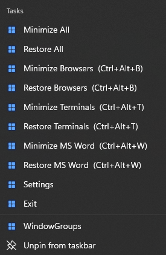
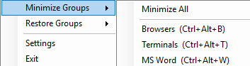

# Window Groups

A lightweight Windows 11 tray utility for minimising and restoring **groups** of
application windows (for example, all browser windows or all console/terminal
windows) with one click or a global keyboard shortcut.

- C# / .NET 8 / Windows Forms
- No external NuGet dependencies (xUnit is used only by the test project)
- No database, no network, no administrator privileges required

## Features

- Runs in the system tray — no permanent main window.
- Context menu with dynamically generated **Minimize Groups** and
  **Restore Groups** sub-menus.
- Built-in groups:
  - **Browsers** — `chrome`, `msedge`, `firefox`, `brave`
  - **Consoles / Terminals** — `WindowsTerminal`, `cmd`, `powershell`, `pwsh`
  - **Microsoft Word** — `WINWORD`
- Create, edit, enable/disable and delete your own groups.
- Configurable global hotkeys that toggle a group — minimise its windows when
  visible and restore them when minimised (defaults: `Ctrl+Alt+B` = Browsers,
  `Ctrl+Alt+C` = Consoles / Terminals, `Ctrl+Alt+W` = Microsoft Word).
- Optional "Start with Windows".
- JSON configuration under `%LOCALAPPDATA%\WindowGroups\`.
- Restoring returns every currently minimised window that matches a group.
- Single instance: launching it again while it is already running simply opens
  the running instance's Settings window.
- Taskbar jump list: right-clicking the pinned taskbar icon gives quick access to
  Minimize/Restore for every group, plus Settings and Exit.

## Requirements

- Windows 11 (also works on Windows 10 with a recent .NET runtime).
- To run the framework-dependent build:
  [.NET 8 Desktop Runtime](https://dotnet.microsoft.com/download/dotnet/8.0).
- To build from source:
  [.NET 8 SDK](https://dotnet.microsoft.com/download/dotnet/8.0).

## Building

```powershell
# Build all projects (Debug)
dotnet build WindowGroups.sln

# Build Release
dotnet build WindowGroups.sln -c Release

# Run the tests
dotnet test WindowGroups.sln
```

The application executable is produced at
`src\WindowGroups\bin\Release\net8.0-windows\WindowGroups.exe`.

## Running

```powershell
dotnet run --project src\WindowGroups
```

or launch `WindowGroups.exe` directly. On first run the default configuration is
used and a log file is created at
`%LOCALAPPDATA%\WindowGroups\windowgroups.log`.

## Deployment

### Framework-dependent (recommended)

Run `WindowGroups.exe` alongside the generated `.dll` files. The user needs the
.NET 8 Desktop Runtime installed.

### Self-contained single file

```powershell
dotnet publish src\WindowGroups\WindowGroups.csproj `
  -c Release -r win-x64 --self-contained true `
  -p:PublishSingleFile=true -p:IncludeNativeLibrariesForSelfExtract=true
```

This produces a single `WindowGroups.exe` (in
`src\WindowGroups\bin\Release\net8.0-windows\win-x64\publish\`) that runs on
machines without the .NET runtime installed. It is large (~160 MB) because it
bundles the runtime.

## Usage

1. Right-click the tray icon to open the menu.
2. **Minimize Groups** / **Restore Groups** lists each configured group, plus a
   **Minimize All** / **Restore All** action at the top of each menu.
3. **Settings** opens the settings dialog where you can:
   - Rename groups, edit descriptions, toggle enable/disable.
   - Add/remove executable names (without the `.exe` extension).
   - Assign a keyboard shortcut (click **Set...** and press the key
     combination; press `Esc` to cancel, **Clear** to remove).
   - Add, remove and restore-default groups.
   - Toggle **Start with Windows**.
4. Use the default hotkeys `Ctrl+Alt+B` and `Ctrl+Alt+C`, or your own.

## Configuration

Configuration is stored in JSON at:

```
%LOCALAPPDATA%\WindowGroups\config.json
```

A missing or corrupt file falls back to the defaults (a corrupt file is backed
up with a `.corrupt-<timestamp>` suffix). Example:

```json
{
  "Version": 1,
  "StartWithWindows": false,
  "Groups": [
    {
      "Id": "browsers-default",
      "Name": "Browsers",
      "Description": "Web browsers",
      "ExecutableNames": [ "chrome", "msedge", "firefox", "brave" ],
      "Hotkey": "Ctrl+Alt+B",
      "Enabled": true
    },
    {
      "Id": "consoles-terminal-default",
      "Name": "Consoles / Terminals",
      "Description": "Console and terminal windows",
      "ExecutableNames": [ "WindowsTerminal", "cmd", "powershell", "pwsh" ],
      "Hotkey": "Ctrl+Alt+C",
      "Enabled": true
    }
  ]
}
```

Hotkeys are serialised as a human-readable string (`Ctrl`, `Alt`, `Shift`,
`Win` modifiers followed by a key such as `A`–`Z`, `0`–`9`, `F1`–`F24`, or named
keys like `Home`, `End`, `PageUp`, `Space`, `Left`, etc.).

## Automatic startup

Enable **Start with Windows** in Settings, or add/remove the `WindowGroups`
value manually under the registry key:

```
HKEY_CURRENT_USER\Software\Microsoft\Windows\CurrentVersion\Run
```

The value points at the application executable (quoted path). This requires no
administrator privileges. Alternatively, place a shortcut to
`WindowGroups.exe` in the Startup folder
(`%APPDATA%\Microsoft\Windows\Start Menu\Programs\Startup`).

## Taskbar jump list & command line

While running, Window Groups registers a jump list on its taskbar icon, so
right-clicking the pinned icon offers **Minimize All** / **Restore All**,
per-group **Minimize**/**Restore**, plus **Settings** and **Exit**.

These entries launch the app with a command-line switch that is forwarded to the
already-running instance over a local named event (so no duplicate process or
tray icon is created):

```
WindowGroups.exe --minimize <group-id-or-name>
WindowGroups.exe --restore <group-id-or-name>
WindowGroups.exe --minimize-all
WindowGroups.exe --restore-all
WindowGroups.exe --settings
WindowGroups.exe --exit
```

Launching with no arguments while the app is already running opens its Settings
window.

> Note: the jump list is keyed to the app's AppUserModelID. If you pinned the
> icon before this build, unpin it and pin it again so the jump list attaches to
> the taskbar icon.

## Project structure

```
src/
  WindowGroups.Core/          Library with no WinForms dependency
    Models/                   ApplicationGroup, WindowInfo, Hotkey, results
    Configuration/            ConfigurationService, defaults, JSON converter
    Interop/                  Win32 P/Invoke + abstractions (IWindowApi, IHotkeyApi)
    Services/                 WindowManager, ProcessWindowEnumerator,
                              HotkeyManager, StartupService, matching logic
    Logging/                  ILogger, FileLogger, NullLogger
  WindowGroups/               WinForms executable (UI)
    UI/                       TrayApplicationContext, SettingsForm,
                              HotkeyMessageWindow, HotkeyMapper
    Program.cs                Composition root
tests/
  WindowGroups.Tests/         xUnit tests + fakes
scripts/
  generate-icon.ps1           Regenerates app_icon.ico
```

### Design notes

- **Window management is independent of WinForms.** The whole window-management
  pipeline lives in `WindowGroups.Core` (a plain class library) behind the
  `IWindowApi` and `IProcessNameResolver` abstractions, so it can be tested
  without a desktop and reused later.
- Restoring enumerates each group's matching windows and returns every currently
  minimised one to visible (including windows minimised by other apps or a
  previous session, and windows on other virtual desktops), skipping destroyed
  handles safely. Minimising still targets only visible, user-facing windows.
- Windows are filtered to user-facing windows: invisible, tool
  (`WS_EX_TOOLWINDOW`) and DWM-cloaked windows are ignored; the application never
  acts on its own process.
- Hotkey conflicts (already registered by another app) are detected via the
  Win32 error `ERROR_HOTKEY_ALREADY_REGISTERED` and reported.

## Testing

```powershell
dotnet test WindowGroups.sln
```

Covered areas include configuration save/load and recovery, group creation and
cloning, executable-name matching, window enumeration and filtering, minimise and
restore behaviour, invalid window handles, and hotkey registration/conflicts.

## Screenshots





